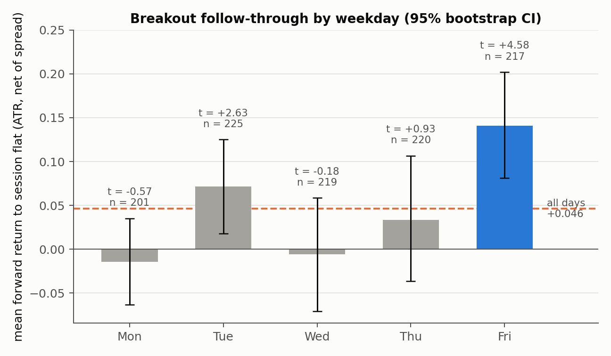
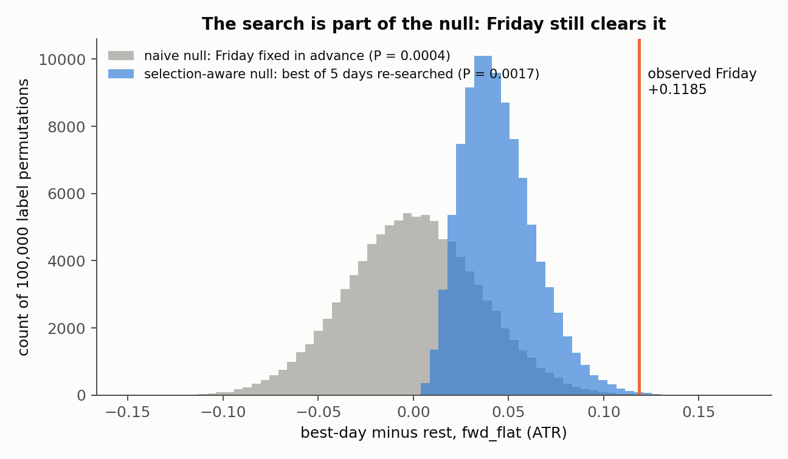
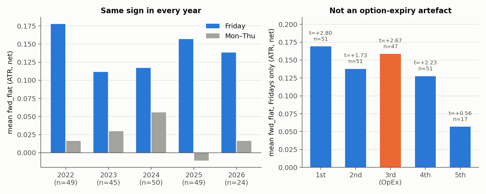
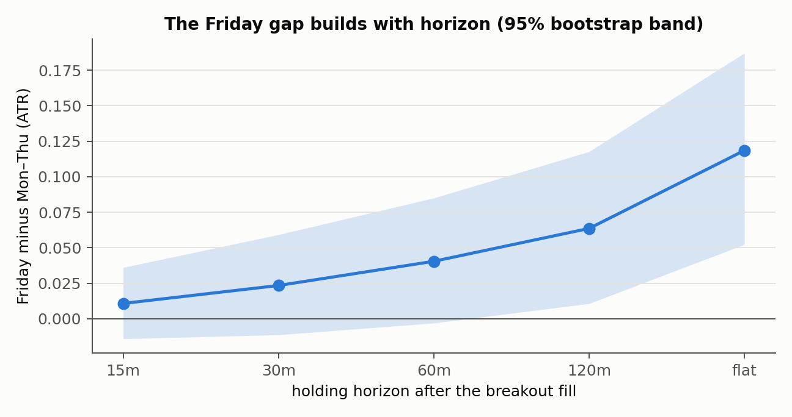

# Day-of-Week Structure in NASDAQ-100 Opening-Range Breakouts

**Does an opening-range breakout on the NASDAQ-100 follow through more on some days of the week than others, and does the answer survive a test that accounts for having searched for it?**

1,082 New York-session breakouts on US100 (NASDAQ-100 CFD), January 2022 to July 2026, 5-minute bars, every return net of the spread actually paid at the fill.



## Result

| | n | Mean forward return to session close (ATR, net) | t-stat |
|---|---:|---:|---:|
| All breakouts | 1,082 | +0.046 | +3.32 |
| **Friday** | 217 | **+0.141** | **+4.58** |
| Monday to Thursday | 865 | +0.022 | +1.45 |

* **Friday breakouts travel about 3× further than the average breakout.** The Friday-minus-rest gap is **+0.119 ATR**.
* **It survives a selection-aware permutation test.** Friday was found by comparing five days, so the null hypothesis has to repeat that comparison. With 100,000 shuffles, **P = 0.0017**. A naive test that assumes Friday was chosen in advance gives P ≈ 0.0003, so the search costs about one order of magnitude of significance.
* **It is stable.** It is positive in every year from 2022 to 2026, it is not concentrated in option-expiry week, and the gap widens steadily with holding horizon.



## Methodology

### Event definition
* **Opening range (OR):** high and low of 09:30 to 10:00 New York time.
* **Breakout:** the first 5-minute bar between 10:00 and 11:00 that trades a buffer $\delta$ beyond the range ($\delta$ = 10 broker points = 0.10 index points). Entry is at the stop level $E_i = \text{OR}_{\text{high}} + \delta$ for a long, or $\text{OR}_{\text{low}} - \delta$ for a short.
* **Clock:** broker timestamps (EET/EEST) are mapped to New York time through the tz database rather than a fixed offset. This matters for the weeks when US and EU daylight saving disagree.

### Outcome variable
Forward return at horizon $h$, signed by the breakout side $s_i \in \{-1,+1\}$, normalised by the 14-day Wilder ATR known at the prior session's close, net of the spread at the fill:

$$y_{i,h} \;=\; \frac{s_i\,(C_{t_i+h}-E_i)}{\text{ATR}_i}\;-\;\frac{\text{spread}_{t_i}}{\text{ATR}_i}, \qquad h \in \{15, 30, 60, 120\text{ min},\ \text{flat at 15:30}\}$$

The return deliberately ignores stops and targets ("exit-agnostic"). A hypothesis passes or fails on whether price moved, not on how a particular bracket happened to cut the path. ATR normalisation is used instead of R (the range width) because normalising by the range cancels any signal that is itself a function of range width.

### Testing protocol
Every candidate feature was graded with the same five tests before it could be called a finding:

| Test | What it guards against |
|---|---|
| Quintile monotonicity | a single outlier bucket driving the result |
| Spearman rank correlation, permutation p-value | non-linear or rank-only structure |
| Per-year sign agreement (≥ 4 of 5 years) | one regime carrying the sample |
| In-sample / out-of-sample split (2022-01 to 2024-07 vs 2024-07 to 2026-07) | in-sample overfitting |
| Placebo: feature shuffled across sessions | spurious structure in the harness |

### The selection-aware null
Choosing the best of five weekdays is a search, so the test statistic is the *maximum* gap:

$$T^{\text{obs}} = \max_{d\,\in\,\{\text{Mon..Fri}\}} \left(\bar y_d - \bar y_{\neg d}\right), \qquad
p = \frac{1}{B}\sum_{b=1}^{B} \mathbf{1}\!\left[\max_d \left(\bar y^{(b)}_d - \bar y^{(b)}_{\neg d}\right) \ge T^{\text{obs}}\right]$$

Weekday labels are permuted across sessions $B = 100{,}000$ times and the full search is re-run on each permutation. The Monte-Carlo standard error of $p$ is $\sqrt{p(1-p)/B} \approx 0.0001$.

## Robustness



| Check | Result |
|---|---|
| Per year (Friday, fwd_flat) | 2022 +0.178 · 2023 +0.112 · 2024 +0.117 · 2025 +0.157 · 2026 +0.138 |
| Option-expiry (3rd) Friday excluded | +0.136, t = +3.81, n = 170 |
| Independent of the pre-session drift signal | Friday with drift against the trade still averages +0.156 (t = +3.50) |
| Horizon profile | the gap builds monotonically, 15 min → session close |



## Limitations

* **Horizon choice.** At a fixed 60-minute horizon, the best *single* day has selection-aware P = 0.074 (`results/p4.log`). The effect is strongest at the session close, and picking that horizon is itself a modelling decision.
* **Forward return is not a strategy.** No stops, sizing or slippage beyond the quoted spread are modelled.
* **One instrument, one broker feed.** The data is a CFD on the index, not the futures contract, and 2026 contains only half a year (24 Fridays).
* **Mechanism.** End-of-week de-risking and dealer gamma positioning are plausible explanations, but neither is tested here.

## Repository layout

```
scripts/
  fwd_harness.py          event builder + the five-test grading harness
  orb_core.py             data loading, opening range, clock handling
  p1_batch.py             first screen of candidate features
  p2_trigger_delay.py     does a later trigger change anything?
  p3_validate.py          IS/OOS, per-year, placebo on the survivors
  p4_selection_aware.py   selection-aware vs naive null at 60 min
  p5_ledger.py            pre-session drift feature
  p6_horizons.py          every survivor across all horizons
  p7_monday.py            is "Tue+Fri" just "not Monday"?
  p8_friday.py            Friday at session close: null, OpEx, per-year, 2×2 cells
results/                  console output of every script + breakout_ledger.csv
figures/make_figures.py   rebuilds every figure from the ledger (no broker data needed)
notebooks/walkthrough.ipynb   executed walkthrough of the evidence
FINDINGS.md               full research log, including every rejected hypothesis
```

## Reproducing

```bash
pip install -r requirements.txt
python figures/make_figures.py          # figures from the saved ledger
jupyter notebook notebooks/walkthrough.ipynb
```

To re-run the full pipeline from raw bars, see [`data/README.md`](data/README.md) for the expected MT5 export format, then:

```bash
export BROKER_DATA_DIR=/path/to/mt5/export
cd scripts && for s in p1_batch p2_trigger_delay p3_validate p4_selection_aware p5_ledger p6_horizons p7_monday p8_friday; do python $s.py; done
```

Random seeds are fixed, and `p4` reproduces its logged output byte-for-byte.

---
*Author: Muhammad Talal Malik · Business Data Analytics, COMSATS University*
